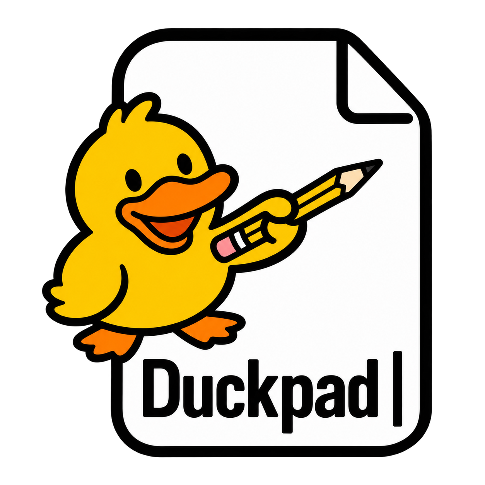
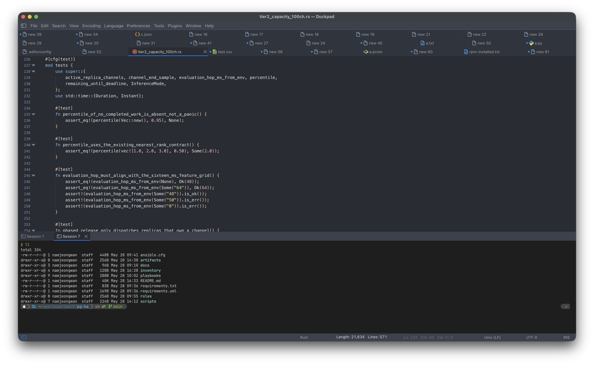

# Duckpad

<p align="center">
  
</p>

Duckpad is a text and code editor for macOS, inspired by [Notepad++](https://github.com/notepad-plus-plus/notepad-plus-plus).

It brings familiar text editing to the Mac with native menus, multiple document tabs, split editor groups, syntax highlighting, search and replace, and document comparison.



[Website](https://namjeongwan.github.io/duckpad/) · [한국어](https://namjeongwan.github.io/duckpad/ko/)

## Download

Install with Homebrew:

```sh
brew install --cask namJeongwan/duckpad/duckpad
```

Homebrew automatically adds the [Duckpad tap](https://github.com/namJeongwan/homebrew-duckpad).

Or [download Duckpad](https://github.com/namJeongwan/duckpad/releases/latest) for manual installation.

Requires macOS 13 or later. Supports Apple Silicon and Intel Macs.

This early release is not notarized by Apple. See the release notes for installation instructions.

## Terminal

Duckpad automatically installs the `duckpad` command on the first launch after
installation or an update. Open a new terminal window, then run:

```sh
duckpad .
duckpad test.txt
duckpad a.txt b.txt
```

Folders open in the workspace sidebar; existing files open in editor tabs.
An already running Duckpad receives the request in its active window.

The command lives in `~/.local/bin`. Duckpad appends a PATH entry to `.zprofile`
and `.bash_profile` for zsh and bash without replacing existing settings or
another `duckpad` command. Existing commands on PATH retain priority. Custom
startup locations (including `ZDOTDIR`) and other shells need `~/.local/bin` on their PATH.
To uninstall the command, remove `~/.local/bin/duckpad`; the PATH entry can stay
if other programs use that directory.

## Plugins

Open **Plugins → Plugins Admin** to install, enable, disable or remove optional
plugins. Published packages are listed in **Available Plugins** in the
[official catalog](https://github.com/namJeongwan/duckpad-plugins). You can also
download a release ZIP, extract it and select its `.duckpad-plugin` folder with
**Install Plugin**. Native plugins require explicit code-trust authorization.

| Plugin | Features | Availability | Minimum host API / runtime |
| --- | --- | --- | --- |
| [Duckpad Text Tools](Samples/DuckpadTextTools) | Sort selected lines; trim trailing whitespace | Bundled, 1.0.0 | API 1.0; no external runtime |
| [Clipboard History](https://github.com/namJeongwan/duckpad-plugin-clipboard-history) | Search, pin and paste local clipboard history | Optional, published 0.3.2 | API 1.3; native module |
| [PlantUML](https://github.com/namJeongwan/duckpad-plugin-plantuml) | Local diagram preview, zoom, larger window, PNG/SVG export | Optional, published 0.1.1 | API 1.4; managed Java/PlantUML setup or verified local paths |
| [Python](https://github.com/namJeongwan/duckpad-plugin-python) | LSP completion with independent workspace interpreter/server settings | Optional, published 0.1.0 | API 1.5; separately installed basedpyright (default), Pyright or ty |
| [Ruby/Rails](https://github.com/namJeongwan/duckpad-plugin-ruby) | LSP completion and workspace settings | Optional, published 0.1.0 | API 1.5; separately installed Ruby LSP and project environment |
| [Rust](https://github.com/namJeongwan/duckpad-plugin-rust) | LSP completion and workspace settings | Optional, published 0.1.0 | API 1.5; separately installed rust-analyzer and project toolchain |
| [D2](https://github.com/namJeongwan/duckpad-plugin-d2) | Local `.d2` preview, zoom, larger window, PNG/SVG export | Optional, published 0.1.0 | API 1.6; verified D2 0.9.0 setup or a compatible local executable |
| [Mermaid](https://github.com/namJeongwan/duckpad-plugin-mermaid) | Local `.mmd`/`.mermaid` preview, zoom, larger window, PNG/SVG export | Optional, published 0.1.0 | API 1.4; embedded Mermaid 12.0.0, no external runtime |

Duckpad **0.18.0** provides host API **1.6.0**. Earlier Duckpad **0.17.0**
provides API **1.5.0** and cannot load the D2 plugin. Diagram plugins are installed
separately from the app. See [D2 setup](docs/plugins/d2.md) and
[Mermaid setup](docs/plugins/mermaid.md) for installation, local builds and limits.

Current-document/keyword completion, syntax highlighting and Mermaid fenced
blocks in Markdown preview are built into Duckpad. The language plugins add
semantic completion using external servers; the standalone diagram plugins add
their preview panels. See [plugin documentation](docs/plugins/overview.md),
[PlantUML setup](docs/plugins/plantuml.md), and
[workspace language support](SDK/LanguageSupport/language-support.md).

## Development

Requires macOS and Xcode Command Line Tools with Swift 6 or later. Run the commands below from the repository root.

```sh
swift run DuckpadApp
```

## Build

The integrated terminal builds Ghostty from pinned source. Xcode's Metal toolchain is required (`xcodebuild -downloadComponent MetalToolchain`); the first build also downloads a verified Zig toolchain. Before running SwiftPM commands directly, run `scripts/build_ghostty.sh --architecture native` once. App packaging performs this step automatically.

Create a universal `.app` for Apple Silicon and Intel Macs:

```sh
scripts/build_macos_app.sh --output build/Duckpad.app
```

Add `--architecture native` to build only for your Mac. The output path must not already exist. The default build uses ad-hoc signing without Apple notarization.

## Languages

- [ ] English
- [ ] Korean
- [ ] Japanese
- [ ] Chinese (Simplified)
- [ ] Portuguese (Brazil)
- [ ] Italian
- [ ] French
- [ ] German
